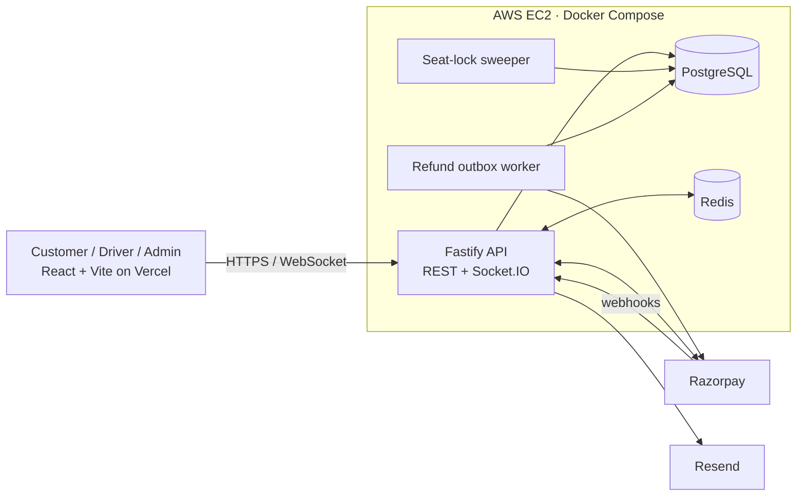
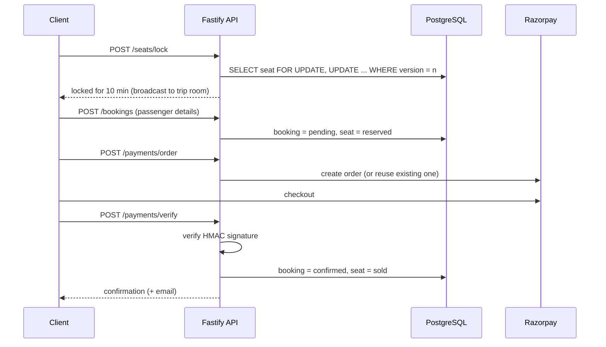

# Mannat Transportation — Bus Booking Platform

A full-stack, real-time bus ticket booking system built for **Mannat Transportation**, a single-operator bus company. Customers search trips, pick seats on a live seat map, and pay with Razorpay; drivers see their assigned trips; admins manage trips, vehicles, drivers, bookings and refunds.

> Built as a freelance contract (Mar 2026 – Sep 2026). Backend runs on AWS EC2 (provisioned with Terraform); frontend is deployed on Vercel.

**Live demo:** 
[_add link_](https://mannattravel.com/)

---

## Highlights

- **No double-booking under concurrency.** Seat locks use `SELECT … FOR UPDATE` plus an optimistic `version` column, so two users racing for the same seat can never both get it.
- **Real-time seat map.** Seat state changes are broadcast over Socket.IO to everyone viewing the trip, scaled across instances with the Redis adapter.
- **Self-healing locks.** Locks expire after 10 minutes; a background sweeper releases abandoned seats every 30 seconds and notifies connected clients.
- **Reliable refunds via a transactional outbox.** Cancelling a trip writes refund jobs in the *same* database transaction as the cancellation. A worker claims jobs with `FOR UPDATE SKIP LOCKED`, retries with exponential backoff, and reclaims jobs from crashed workers using a lease timeout.
- **Safe payments.** Server-side pricing, HMAC-SHA256 verification of Razorpay signatures and webhooks, re-use of an existing order on retry, and an append-only payment event log.
- **Infrastructure as code.** EC2, security group, Elastic IP and key pair defined in Terraform; pushes to `main` deploy automatically through GitHub Actions.

---

## Tech Stack

| Layer | Technologies |
|---|---|
| **Backend** | Node.js, Fastify 5, TypeScript, Zod (`fastify-type-provider-zod`) |
| **Database** | PostgreSQL 17, Drizzle ORM (SQL migrations), Redis |
| **Real-time** | Socket.IO with `@socket.io/redis-adapter` |
| **Payments** | Razorpay (orders, checkout verification, webhooks, refunds) |
| **Auth** | JWT in httpOnly cookies, bcrypt, Google OAuth 2.0, role-based guards |
| **Email** | Resend (booking confirmations, password reset) |
| **Frontend** | React 19, Vite, Tailwind CSS 4, TanStack Query, Zustand, React Hook Form |
| **Testing** | Vitest integration tests against a real PostgreSQL test database |
| **Infra / DevOps** | AWS EC2, Terraform, Docker Compose, GitHub Actions, Vercel |

---

## Architecture



### Backend structure

```
backend/src/
├── app.ts              # Fastify app factory: plugins, rate limiting, routes
├── core/
│   ├── auth.ts         # JWT plugin (fastify.authenticate)
│   ├── guards.ts       # requireRole(...) preHandler
│   ├── socket.ts       # Socket.IO + Redis adapter, trip rooms
│   ├── emitter.ts      # Typed internal event bus
│   ├── SeatLockSweeper.ts
│   ├── refundProcessor.ts
│   ├── email.ts        # Resend
│   └── errors.ts / errorHandler.ts
├── db/
│   ├── schema/         # One file per table + relations
│   └── migrations/     # Generated by drizzle-kit
└── modules/            # auth, users, trips, seats, bookings, payments, vehicles
    └── <module>/  *.routes.ts · *.service.ts · *.validation.ts · *.test.ts
```

Each module follows **Route → Service → DB**. Routes declare Zod schemas for type-safe validation; services hold the business logic and throw typed errors (`NotFoundError`, `ConflictError`, …) that a global handler maps to HTTP status codes.

---

## How the booking flow works



If a payment fails, the seat goes back to `available`. If a lock expires before checkout, the sweeper releases it.

### Refunds: transactional outbox

When an admin cancels a trip, a single transaction:
1. marks the trip `cancelled`,
2. cancels its bookings and frees their seats, and
3. inserts one row per paid booking into `refund_outbox`.

A background worker polls every 15 seconds:
- claims up to 10 due jobs with `FOR UPDATE SKIP LOCKED`, so multiple workers never process the same refund;
- sets a `leasedAt` timestamp, and a job stuck in `processing` for over 5 minutes (the worker crashed) is picked up again;
- on failure, retries with exponential backoff (capped at 15 minutes) up to 5 attempts, then marks the job `failed`;
- admins can view failed refunds and retry them from the dashboard.

The cancellation can never succeed while its refund is silently lost, because both are committed together or not at all.

---

## Roles

| Role | Can do |
|---|---|
| **Customer** | Search trips, lock seats, book and pay, view and cancel bookings (up to 2 hours before departure) |
| **Driver** | Register (pending admin approval), view assigned trips |
| **Manager / Admin** | Create and manage trips and vehicles, approve drivers, view all bookings, cancel trips, monitor and retry refunds |

---

## API overview

All routes are prefixed with `/api/v1`.

| Module | Endpoints |
|---|---|
| `/auth` | register, login, logout, `/me`, Google OAuth callback, forgot / reset password |
| `/trips` | list and search, locations, details, seat map, stats, admin CRUD, status transitions |
| `/seats` | lock, unlock |
| `/bookings` | create, list, details, cancel |
| `/payments` | create order, verify, failure, webhook, refund outbox list and retry |
| `/vehicles` | list, create |
| `/users` | list, update status (driver approval) |

Rate limited to 100 requests per minute per client.

---

## Running locally

**Prerequisites:** Node.js 20+, Docker

```bash
git clone https://github.com/henil-codes/travel-bookings.git
cd travel-bookings
cp .env.example .env          # fill in DB, JWT, Razorpay, Resend, Google values

docker compose up -d          # Postgres (5432), test Postgres (5433), Redis, Ngrok

cd backend
npm install
npm run db:migrate
npm run dev                   # API on http://localhost:3000

cd ../frontend
npm install
npm run dev                   # http://localhost:5173
```

Ngrok exposes the local API so Razorpay webhooks can reach it during development.

### Tests

```bash
cd backend
npm run db:migrate:test
npm test
```

Tests are **integration tests against a real PostgreSQL database** (not mocks), covering auth, password reset, trips, seat locking, Socket.IO events, bookings and payments.

---

## Deployment

- **Infrastructure:** `infra/terraform/` provisions the EC2 instance, security group, Elastic IP and SSH key. A `user_data` script installs Docker on first boot.
- **CI/CD:** on every push to `main`, GitHub Actions syncs the backend to the server over SSH and runs `deploy/deploy.sh`, which rebuilds the API image, applies database migrations, then restarts the Docker Compose stack (API, Postgres, Redis).
- **Frontend:** deployed on Vercel.
- Postgres and Redis are bound to `127.0.0.1` on the host, so they're not reachable from the internet.

---

## Design decisions

- **Pessimistic + optimistic locking together.** `FOR UPDATE` serializes contenders inside a transaction; the `version` check is a second guard against lost updates.
- **Outbox kept in Postgres, not a queue.** Refunds must commit atomically with the cancellation. A separate queue (e.g. BullMQ) would reintroduce the dual-write problem, so it's reserved for non-critical jobs like email.
- **Money as integers.** All amounts are stored in paise to avoid floating-point errors.
- **Single-operator model.** Started as a multi-operator marketplace and was redesigned around one operator to match the client's actual business: simpler schema, drivers as internal staff.

## Roadmap

- Automatically move bookings to `completed` once a trip finishes
- Zod response schemas on every route, to catch frontend/backend contract drift
- Multi-vehicle trips (deferred until the client confirms the need)

---

## Screenshots


---

Built by **Henilkumar Patel** · [LinkedIn](https://www.linkedin.com/in/henilkumar-patel/) · [GitHub](https://github.com/henil-codes)
